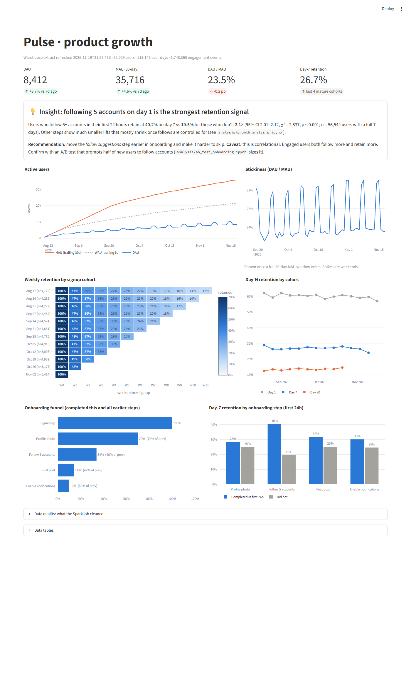
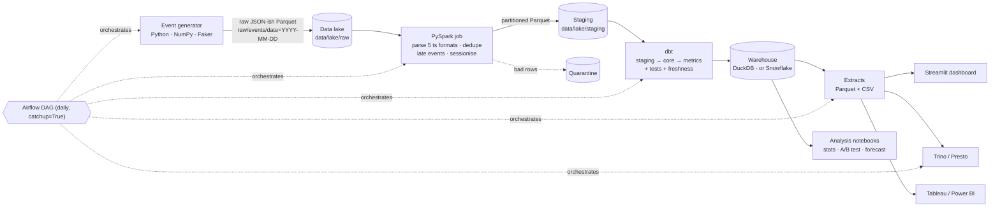
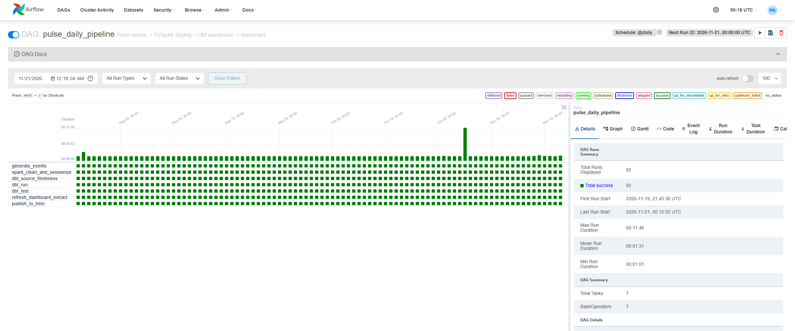
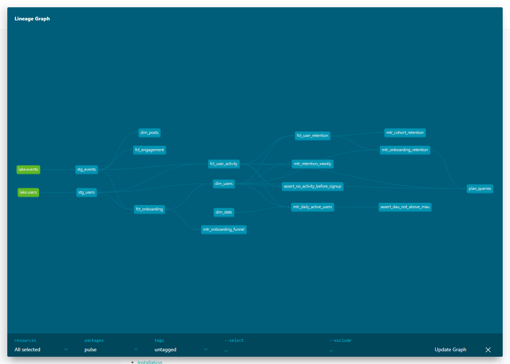
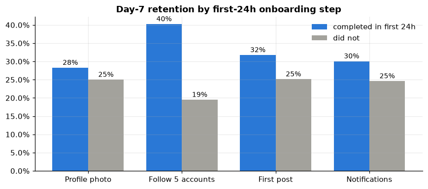
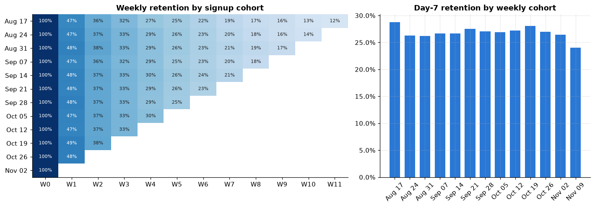
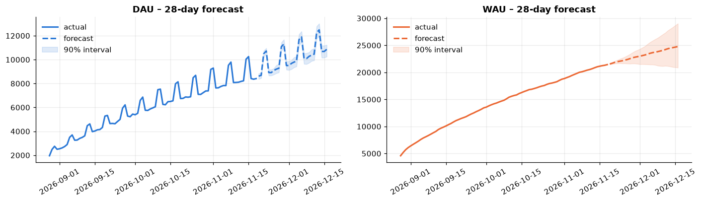

# Product Growth Analytics Warehouse

An end-to-end data platform for **Pulse**, a simulated social app. It generates millions of
messy product events, cleans and sessionises them with **PySpark**, models them into a
**dimensional warehouse with dbt** (tested for uniqueness, relationships and freshness),
orchestrates everything daily with **Airflow**, and answers a product question in a
**dashboard**: *which onboarding steps predict whether a new user is still around a week later?*

> **Finding:** users who follow 5+ accounts in their first 24 hours retain at **40.2%** on
> day 7 vs **19.5%** for those who don't (**2.1×**, 95% CI 2.01–2.12, p < 0.001). Follows
> are the only step that stays significant after controlling for the other steps, channel,
> device and country (adjusted OR 2.69). [Full write-up and limitations ↓](#the-insight)



## Architecture



**Daily DAG** (`airflow/dags/pulse_daily_pipeline.py`):

```
generate_events → spark_clean_and_sessionize → dbt_source_freshness → dbt_run → dbt_test → refresh_dashboard_extract → publish_to_trino
```

* `catchup=True` + `max_active_runs=1`: the first start backfills all 90 days, one day at a time.
* Every task retries 3× with exponential backoff (1 → 15 min).
* `dbt_test` failure fires an alert: task log + `data/alerts/alerts.log`, plus e-mail
  (`PULSE_ALERT_EMAIL`) or Slack (`PULSE_SLACK_WEBHOOK`) when configured.
* Everything is idempotent (deterministic generator, partition overwrite in Spark,
  `delete+insert` incrementals in dbt), so re-running any day is safe.
* Crash-safe writes, learned the hard way when the laptop slept and Docker restarted
  mid-backfill: the generator writes to a hidden temp file and renames it into place,
  the Spark jobs delete leftover `.spark-staging-*`/`_temporary` dirs from killed runs,
  and the dbt sources only read committed `event_date=*` partitions. After each
  interruption, clearing the failed day in Airflow was enough to recover.



*All 90 backfill days plus the first live daily runs, every task green.*

## Run it

Requirements: Docker Desktop (≥ 6 GB RAM for Docker). Nothing else is needed on the host.

```bash
docker compose build
docker compose up -d
```

| Service | URL |
|---|---|
| Airflow (admin / admin) | http://localhost:8080 (set `AIRFLOW_PORT` in `.env` if 8080 is taken) |
| Dashboard | http://localhost:8501 |
| dbt docs + lineage | http://localhost:8081 |
| Trino | http://localhost:8085 |

On first start the DAG is unpaused and backfills 90 days (about 70 s per day, ~1.7 h total).
**Fast path** (all 90 days in ~3 minutes, same result): pause the DAG, then

```bash
docker compose run --rm pipeline          # runs scripts/bootstrap.sh
```

Query the warehouse with Presto/Trino SQL:

```bash
docker compose exec trino trino --catalog hive --schema pulse -f /queries/queries.sql
```

Local development without Docker (generator, dbt, notebooks; Spark needs the container on Windows):

```bash
python -m venv .venv && .venv/Scripts/pip install -r docker/requirements-pipeline.txt -r docker/dashboard/requirements.txt statsmodels nbconvert ipykernel
python -m generator.generate --all
```

## Data volume

| | Rows |
|---|---|
| Raw events received (90 days, 2026-08-21 → 2026-11-18) | **3,019,680** |
| Clean events after Spark | 2,986,212 |
| Sessions (30-min inactivity gap) | 840,414 |
| Users | 62,059 |
| `fct_user_activity` (user-days) | 513,146 |
| `fct_engagement` (likes, comments, follows) | 1,748,360 |
| `dim_posts` | 239,261 |
| Canvas collaboration events (extension) | 904,387 |

Scale is a parameter: `generator/config.py` (`BASE_SIGNUPS_PER_DAY`, `PULSE_SIM_DAYS`).

## Synthetic data design

`generator/` simulates each user's whole lifecycle, deterministically: every draw is seeded by
`(seed, day, stream)`, so the daily Airflow task can regenerate any single day on its own.

* **Users** (~690 signups/day with growth + weekend lift): country, device, acquisition channel,
  age bucket, and a hidden *engagement propensity* that drives both onboarding and retention.
  That's a deliberate confounder, so the analysis has to deal with it.
* **Events:** `signup`, `app_open`, `onboarding_step` (profile_photo, follow_5_accounts, first_post,
  enable_notifications), `post_created`, `like`, `comment`, `follow`.
* **Planted pattern:** completing *follow_5_accounts* in the first 24h multiplies retention
  propensity by 2.5 (other steps 1.1–1.15).
* **Realism:** a loyal core with slow decay plus finite lifetimes, casual users who decay fast,
  weekend seasonality, evening activity peaks, popularity-skewed follows, likes on real posts.
* **Messy on purpose:** see the next section.

## Data quality: issues found and how they're handled

| Issue (planted in raw data) | Volume (full run) | Handling |
|---|---|---|
| Timestamps in 5 formats: epoch-ms, ISO-Z, ISO with local offset (`+05:30`), naive UTC, `MM/dd/yyyy` | every row | `parse_mixed_ts()` in Spark coalesces format-specific parsers into UTC |
| Broken device clocks (1970 / 2099) | 1,500 events | out-of-range rows → `data/lake/quarantine/` with a reason; never reach the warehouse |
| Exact redeliveries (same `event_id`, some a day later) | 23,198 | dedupe on `event_id`, keep first received |
| Client retries (new `event_id`, same payload) | 8,770 | second dedupe on natural key `(user, type, ts, post, target, step)` |
| Late-arriving events (1–2 days) | 43,934 | each run re-reads raw arrivals for `[D-3, D]`, rewrites staging `[D-2, D]`; dbt incrementals reprocess a 3-day window |
| Null device | 60,257 | → `'unknown'` (accepted_values test) |
| Messy casing (`"iOS"`, `"Android "`) | 88,612 | trimmed + lower-cased |
| User profile re-sent with changed device | 306 | latest `received_at` wins (SCD1) |
| Likes on posts whose creation event was quarantined | 867 (0.05%) | **found by the dbt relationships test**, configured to warn above 0 and fail above 5,000 |

Every Spark run writes its metrics to `data/lake/staging/_dq/run=<date>.json`, which the
dashboard shows in its data-quality panel.

## dbt models and tests

```
models/
  staging/   stg_events, stg_users                 (views over the Spark Parquet)
  marts/core/
    dim_users           one row per user: cohort, channel, device, first-24h onboarding flags
    dim_date            calendar (dbt_utils.date_spine)
    dim_posts           one row per post
    fct_user_activity   one row per user per active day (incremental, 3-day lookback)
    fct_engagement      one row per like / comment / follow (incremental)
    fct_onboarding      one row per user: each step's time, flag, within-24h flag
    fct_user_retention  one row per user: D1/D7/D14/D30 retained + eligible
  marts/metrics/
    mtr_daily_active_users, mtr_retention_weekly, mtr_cohort_retention,
    mtr_onboarding_funnel, mtr_onboarding_retention
  collab/    stg_collab_events, fct_team_activity, dim_teams   (extension, off by default)
```

**57 data tests + 2 source-freshness checks** run every day: `unique` / `not_null` on every key; `dbt_utils.unique_combination_of_columns`
on `(user_id, activity_date)`; `relationships` from every fact to `dim_users`, `dim_date` and
`dim_posts`; `accepted_values` on event types, devices and channels; `accepted_range` on counts;
**source freshness** on `_loaded_at` (warn > 24 h, error > 48 h); and custom tests:

* `tests/assert_no_activity_before_signup.sql`: no user is active before their signup date
* `tests/assert_dau_not_above_mau.sql`: DAU ≤ WAU ≤ MAU every day
* `tests/generic/test_is_recent.sql`: a reusable generic test that catches a fact table lagging behind its source

All models use cross-database macros, so the same project runs on DuckDB and Snowflake
(see [`snowflake/`](snowflake/README.md)).



## Analysis

`analysis/growth_analysis.ipynb` (executed, with outputs) covers:

* **DAU / MAU / stickiness**: latest DAU 8.4K, MAU 35.7K, DAU/MAU 23.5%, rising to 28.4% on weekends vs 23.4% on weekdays.
* **Retention cohorts**: weekly heatmap and day-7 retention per signup week (≈27%).
* **Onboarding funnel**: signup → photo 70% → follow 5 accounts 34% → first post 14% → notifications 10%.
* **Which step predicts retention**: 2×2 chi-square tests and risk-ratio CIs per step, a logistic
  regression controlling for the other steps and channel/device/country, and a dose-response by
  time-to-follow.




### The insight

Users who follow 5+ accounts in their first 24 hours retain at **40.2%** on day 7 vs **19.5%**
for those who don't: **2.1×** (95% CI 2.01–2.12, χ² = 2,837, n = 56,544). It's the only step whose
association survives controlling for the other steps, channel, device and country (adjusted odds
ratio 2.69, 95% CI 2.59–2.80). The other steps' raw 1.13–1.26× lifts shrink to 1.07–1.23. Retention
also falls the later the follows happen: 41% when users follow within the first hour vs 18% for
users who never do.

**Recommendation:** onboarding should push follows earlier. Show suggested accounts right after
signup, pre-select popular and friends-of-friends accounts, and nudge users who skip it.

**Limitations:**
* *Correlation, not causation.* Already-engaged users both follow more and retain more. The regression
  only controls for observed variables, and the generator deliberately includes an unobserved one.
* **How to confirm:** an A/B test that prompts a random half of new users to follow 5 accounts during
  onboarding. `analysis/ab_test_onboarding.ipynb` sizes it (≈7.9K users per arm for a +2 pp MDE,
  about 23 days of signups) and analyses a simulated run with an SRM check, two-proportion z-test,
  Wald and bootstrap CIs, and device segments. The simulated result is +4.8 pp (95% CI +3.4 to +6.2).
  That is far less than the 2.1× observational gap, because only users the prompt moves can benefit.
* Day-7 activity is a single-day metric, and the data is synthetic.

## Extensions

| For | What's here |
|---|---|
| Figma DE | `generator/collab.py` + `spark/clean_collab_events.py` + `dbt/models/collab/` + `collab_daily_pipeline` DAG: a second, collaboration-app event set (file edits, comments, invites; ~0.9M events) through the same lake → Spark → dbt pattern. Build it with `dbt build --select path:models/collab --vars '{enable_collab: true}'`. |
| Pinterest DS / Zillow / Databricks | `analysis/ab_test_onboarding.ipynb` (power analysis, SRM, z-test, CIs, bootstrap, segments) and `analysis/wau_forecast.ipynb` (Holt-Winters with weekly seasonality, 14-day back-test MAPE vs seasonal-naive, 28-day forecast with 90% intervals) |
| Meta (Presto) | Trino in Docker over the same marts (`hive.pulse.*`, file metastore + local FS), registered by the DAG's `publish_to_trino` task. Example queries in `trino/queries.sql` |
| NetApp / Zipline | Tableau / Power BI-ready CSV + Parquet extracts and a build guide in [`bi/`](bi/README.md) |
| Snowflake | `snowflake/setup.sql`, `snowflake/load.sh`, and a `snowflake` dbt target |



## Repo layout

```
generator/        event simulator (Pulse + Canvas collab app)
spark/            PySpark jobs
airflow/dags/     daily DAGs
dbt/              models, tests, macros, analyses
analysis/         notebooks (built from build_notebooks.py) + INSIGHT.md
dashboard/        Streamlit app
scripts/          extracts, Trino registration, bootstrap, screenshots
snowflake/ bi/ trino/   platform extensions
docker/           images + Trino config
docker-compose.yml
```
